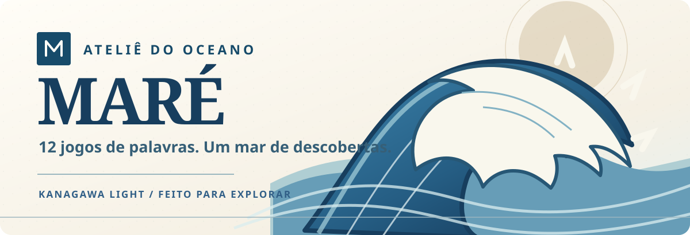
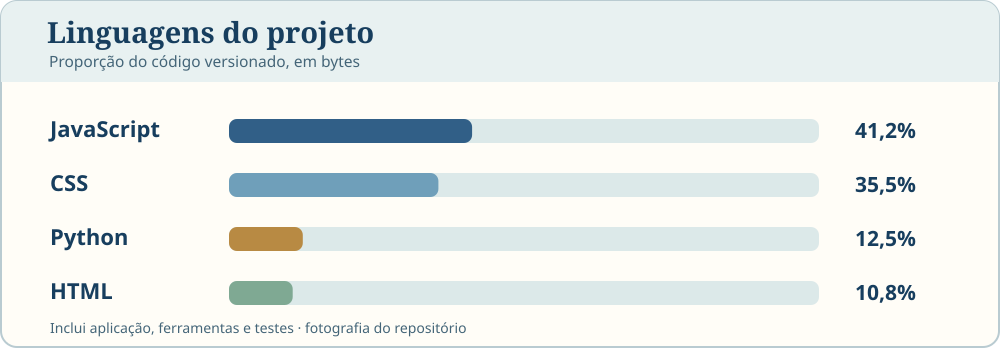

<div align="center">



<br>

**Uma coleção de 12 jogos de palavras em português para jogar, descobrir e explorar.**

[**Jogar agora**](https://paulociano.github.io/mare/) &nbsp; · &nbsp; [**Explorar os jogos**](https://paulociano.github.io/mare/#jogos) &nbsp; · &nbsp; [**Conhecer o design**](docs/KANAGAWA-LIGHT.md)

<br>

[](https://github.com/paulociano/mare/actions/workflows/quality.yml)
[](https://github.com/paulociano/mare/actions/workflows/deploy-pages.yml)

</div>

---

## Sobre o MARÉ

O **MARÉ** reúne jogos de palavras, lógica e associação em uma experiência web gratuita para começar, sem cadastro. Cada jogo tem suas próprias regras, com desafios diários ou modos livres conforme a modalidade.

O projeto é uma aplicação **estática, responsiva e instalável como PWA**. Quando o conteúdo está armazenado no cache, os jogos podem ser acessados offline. O progresso é mantido no navegador nas modalidades que oferecem essa função.

| 12 jogos | 13 páginas | 100% web |
| :---: | :---: | :---: |
| Palavras, lógica e descobertas | Home + um espaço para cada jogo | HTML, CSS e JavaScript |

## Identidade visual · Kanagawa Light

O MARÉ ganhou uma direção visual inspirada na **linguagem de composição e nas cores de *A Grande Onda de Kanagawa*, de Katsushika Hokusai**. O resultado não é uma reprodução da pintura, mas um design original de caráter editorial: papel marfim, tinta azul, espuma suave e movimento contido.

A gravura que acompanha a interface é um **SVG original do projeto**, presente em [`kanagawa-wave.svg`](assets/backgrounds/kanagawa-wave.svg). A mesma linguagem aparece na página inicial, nos tabuleiros, nas cartas de missões e nas imagens de compartilhamento.

| Papel marfim | Azul-prussiano | Índigo oceânico | Névoa |
| :---: | :---: | :---: | :---: |
| `#F8F3E8` | `#315F87` | `#174B6A` | `#E8F1F1` |

Acessibilidade faz parte da identidade, não é um adereço: há navegação por teclado, foco visível e preferências de **alto contraste, tamanho de texto e movimento reduzido**. Para tokens, componentes e decisões visuais, consulte o [guia Kanagawa Light](docs/KANAGAWA-LIGHT.md).

## Explore os 12 jogos

| Jogo | Desafio |
| --- | --- |
| **[Recife](https://paulociano.github.io/mare/recife.html)** | Descubra palavras de cinco letras nos modos Clássico, Dueto e Quarteto. |
| **[Abismo](https://paulociano.github.io/mare/abismo.html)** | Encontre a palavra secreta seguindo pistas de significado. |
| **[Cardume](https://paulociano.github.io/mare/cardume.html)** | Organize 16 palavras em quatro grupos relacionados. |
| **[Corrente](https://paulociano.github.io/mare/corrente.html)** | Reconstrua a resposta conectando letras e sequências. |
| **[Concha](https://paulociano.github.io/mare/concha.html)** | Forme palavras com sete letras e uma letra central obrigatória. |
| **[Trilha](https://paulociano.github.io/mare/trilha.html)** | Ligue letras vizinhas para formar palavras. |
| **[Enigma](https://paulociano.github.io/mare/enigma.html)** | Resolva palavras cruzadas a partir das pistas. |
| **[Marujo](https://paulociano.github.io/mare/marujo.html)** | Encontre palavras escondidas em várias direções. |
| **[Pérola](https://paulociano.github.io/mare/perola.html)** | Resolva anagramas com pistas e tentativas limitadas. |
| **[Farol](https://paulociano.github.io/mare/farol.html)** | Reorganize palavras para reconstruir expressões. |
| **[Náufrago](https://paulociano.github.io/mare/forca.html)** | Descubra a palavra antes de esgotar os erros permitidos. |
| **[Sinais](https://paulociano.github.io/mare/criptograma.html)** | Decifre frases a partir de substituições numéricas. |

## Linguagens e tecnologias

<div align="center">



</div>

<sub>**Como os percentuais foram calculados:** soma dos bytes dos arquivos de código versionados na árvore do repositório, por extensão: JavaScript (`.js`, `.cjs`, `.mjs`), CSS (`.css`), Python (`.py`) e HTML (`.html`). Inclui aplicação, scripts operacionais e testes; não inclui imagens, dados ou Markdown. É um retrato verificável do repositório, não uma estimativa de esforço nem a estatística GitHub Linguist.</sub>

| Tecnologia | Papel no projeto |
| --- | --- |
| **HTML5** | Estrutura semântica das páginas e interfaces dos jogos |
| **CSS3** | Design system Kanagawa, layouts responsivos e feedback visual |
| **JavaScript (Vanilla)** | Lógica dos jogos, interatividade, progresso e recursos offline |
| **Node.js 20+** | Build, consolidação dos estilos e testes de contratos |
| **Python + Playwright** | Testes reais em Chromium, acessibilidade e experiência mobile |
| **GitHub Actions + Pages** | Validação automatizada e publicação do site estático |

O front-end funciona sem framework JavaScript ou backend obrigatório. Os arquivos CSS são organizados por responsabilidade e reunidos, durante o build, em bundles com hash de conteúdo.

## Rodando localmente

Você precisa do **Node.js 20 ou superior**. O projeto não exige instalação de dependências de produção para gerar o site.

```bash
# Clonar
git clone https://github.com/paulociano/mare.git
cd mare

# Executar contratos e testes de lógica
npm test

# Construir a versão publicada
npm run build

# Servir o resultado em http://localhost:8000
python -m http.server 8000 --directory _site
```

Para rodar as verificações estruturais, de código e de build em sequência:

```bash
npm run check
```

A suíte completa de navegador, com Chromium e Playwright, também é executada pelo [GitHub Actions](https://github.com/paulociano/mare/actions/workflows/quality.yml).

## Organização do código

```text
mare/
├── index.html                  # Catálogo de jogos
├── *.html                      # 12 páginas de jogo
├── src/
│   ├── scripts/
│   │   ├── games/              # Regras e interações específicas
│   │   └── shared/             # Progresso, PWA, acessibilidade e social
│   └── styles/
│       ├── games/              # Tabuleiros e elementos próprios
│       └── shared/             # Identidade Kanagawa e UI compartilhada
├── assets/
│   ├── backgrounds/            # Gravuras e cenários
│   ├── brand/                  # Marcas, favicon e ícones
│   └── readme/                 # Artes da documentação
├── data/                       # Desafios e conteúdo
├── scripts/                    # Build e auditorias
├── tests/                      # Testes de lógica e contratos
├── config/                     # Manifesto da aplicação
└── docs/                       # Arquitetura e design system
```

A aplicação é gerada em `_site/` e publicada pelo GitHub Pages. Os estilos de autoria são consolidados **sem mudar as URLs dos jogos nem as regras de persistência**.

## Qualidade e documentação

- [**Arquitetura e organização**](docs/ARCHITECTURE.md): responsabilidades, rotas, dados e contratos de desenvolvimento.
- [**Design system Kanagawa Light**](docs/KANAGAWA-LIGHT.md): princípios, paleta, interface e acessibilidade.
- [**Design system de base**](docs/DESIGN-SYSTEM.md): componentes e evolução visual.
- [**Pipeline de assets**](docs/ASSET-PIPELINE.md): como os estilos e arquivos são publicados.
- [**Auditoria de outubro de 2026**](docs/AUDITORIA-2026-10.md): correções de interface, jogabilidade, desempenho offline e motion.
- [**Testes e workflows**](.github/workflows/quality.yml): gameplay, Chromium, responsividade, WCAG e PWA.

## Créditos

O MARÉ é um projeto independente de jogos de palavras em português.

O modo **Recife** utiliza vocabulário derivado de [pythonprobr/palavras](https://github.com/pythonprobr/palavras), com dados originados de um corretor ortográfico distribuído sob a licença [MPL-2.0](https://www.mozilla.org/en-US/MPL/2.0/).

As fontes **DM Sans** e **Outfit** (SIL Open Font License 1.1, licenças em `assets/fonts/`) e a biblioteca de animação **GSAP** ([licença padrão GreenSock](https://gsap.com/standard-license)) são servidas pelo próprio site, para funcionar igual online e offline.

A identidade Kanagawa Light presta homenagem à tradição das gravuras japonesas, com referência artística a *A Grande Onda de Kanagawa*. A ilustração de ondas do MARÉ é uma criação vetorial própria.

---

<div align="center">

**A próxima descoberta começa com uma palavra.**

[**Jogar MARÉ →**](https://paulociano.github.io/mare/)

</div>
