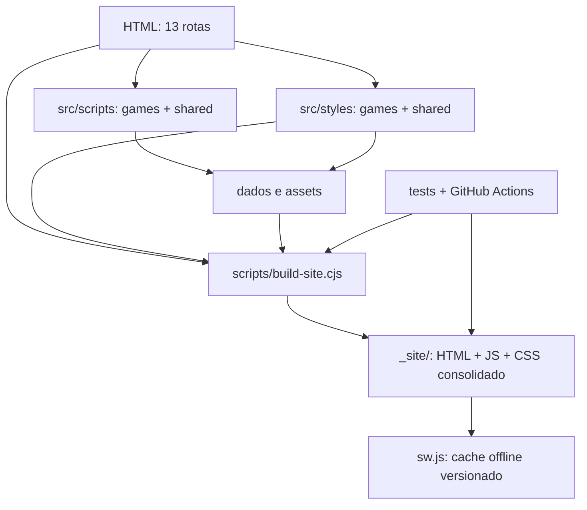

# Arquitetura do MARÉ

MARÉ é uma aplicação **estática e sem dependências obrigatórias de runtime**, com 12 jogos, 13 rotas públicas e deploy via GitHub Pages. A arquitetura separa autoria, empacotamento e artefato publicado. O histórico de fases fica no Git, sem duplicar relatórios na árvore de trabalho.

## Estrutura canônica

```text
/
├── index.html, <jogo>.html   # 13 URLs públicas (não mover)
├── src/
│   ├── scripts/
│   │   ├── games/            # motores de jogo e modos específicos
│   │   └── shared/           # progresso, acessibilidade, social, PWA e hub
│   └── styles/
│       ├── games/            # tabuleiros, teclados e modos individuais
│       └── shared/           # camadas visuais, marca e UI transversal
├── assets/
│   ├── backgrounds/
│   └── brand/
├── data/                     # dicionários e puzzles
├── config/site-manifest.json # 13 rotas, arquivos dinâmicos e conteúdo offline
├── scripts/                  # build, validadores e scripts operacionais
├── tests/                    # contratos de jogo e integrações
├── docs/                     # documentação viva
├── .github/workflows/        # GitHub Actions e publicação
└── _site/                    # saída gerada (não versionada)
    └── styles/mare-<hash>.css
```

## Contratos operacionais

- **URLs e navegação:** manter `index.html` e as 12 rotas `<jogo>.html` na raiz. Links entre jogos permanecem relativos à raiz.
- **JavaScript:** scripts compartilhados e de jogo conservam a sequência declarada no HTML; mudanças de escopo/ordem requerem testes de interação.
- **CSS:** fontes especializadas em `src/styles`, com consolidação e fingerprint no build. Preservar a ordem original das camadas. Detalhes em [ASSET-PIPELINE.md](ASSET-PIPELINE.md).
- **Assets relativos:** fontes CSS dentro de `src/styles/{games,shared}` referem imagens como `../../../assets/...`. O bundler recalcula o caminho no CSS servido por `_site/styles/`.
- **CSS dinâmico:** somente `src/styles/shared/mare-diagnostics.css` precisa ficar diretamente publicado, pois o diagnóstico o injeta em runtime.
- **Persistência:** não alterar nomes de `localStorage`, formato de saves, desafios diários nem resultados verificados sem migração explícita.
- **Offline:** service worker gerado por hash de conteúdo e instalação/atualização conduzida pelo usuário. Não introduzir recarregamento automático durante partidas.
- **Acessibilidade:** manter navegação por teclado, foco visível, estados ARIA, preferências de contraste/escala e redução de movimento.
- **Segurança:** inputs validados, escaping em conteúdo gerado e nenhum segredo/cadastro obrigatório. Evitar dependências introduzidas apenas para refatorar.

## Fluxo de desenvolvimento

Node.js 20+ e Python + Playwright apenas no CI de browser.

```bash
npm test        # contratos e lógica dos jogos
npm run build   # gera _site/
npm run check   # estruturas, contratos, build e referências
```

O workflow `Validar MARÉ` realiza testes reais em Chromium para os 12 jogos, cenários offline, responsividade e verificações de acessibilidade. **Não aprovar alterações de cascata, assets, saves ou rotas apenas por lint ou testes estáticos.**

## Mapa de dependências



## Critério de remoção

Eliminar arquivo de produção somente quando nenhum HTML, JavaScript, stylesheet, manifesto, import dinâmico, worker ou teste precisar dele. Relatórios históricos antigos foram retirados do HEAD; permanecem disponíveis no Git. Componentes `mare-v2`/`mare-3` têm nomes históricos, mas não são automaticamente código morto: uma futura fusão física requer inventário de seletores e comparação visual antes/depois.
